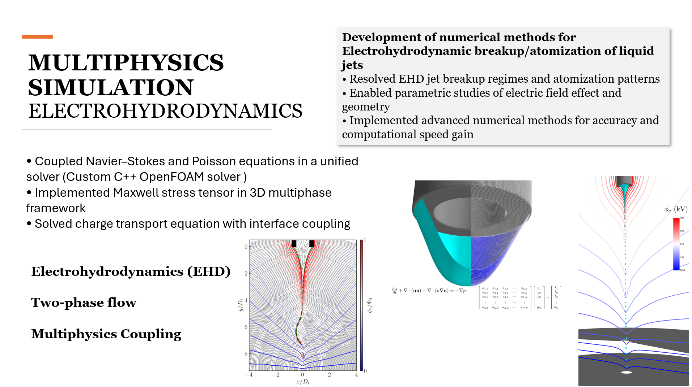

### Challenge
Electrically driven liquid jets (Taylor cone jets) are used in electrospray, inkjet printing, coatings and colloid thrusters. Predicting their shape, instabilities and droplet sizes requires coupling fluid flow, electric fields and a moving liquid surface.

### What I did
- **Developed and validated a 3D two-phase EHD solver** (OpenFOAM/C++): implemented the electrostatic field, Maxwell stresses and charge conservation, with interface-tracking methods (VOF and level-set) for an accurate liquid surface.
- **Linked jet breakup to spray simulation** with an algorithm that converts the detached liquid into individually tracked charged droplets while conserving mass, momentum and charge.
- Was **Principal Investigator of two competitive national supercomputing projects**, scoping the simulation campaigns and deploying the solver on HPC clusters (MPI, SLURM).

### Outcome
Validated within 2% against theory, numerical benchmarks and experiments; captured 3D whipping instabilities of Taylor cone jets for the first time in simulation ([Physics of Fluids, 2023](https://doi.org/10.1063/5.0151109)).

### Code and links
- [interIsoFoamEHD — open-source solver on GitHub](https://github.com/silviomcandido/interIsoFoamEHD)
- [ElectroJetFlow project website](https://silviomcandido.github.io/webJet/index.html)
- [PhD thesis](https://hdl.handle.net/10400.6/14426)
