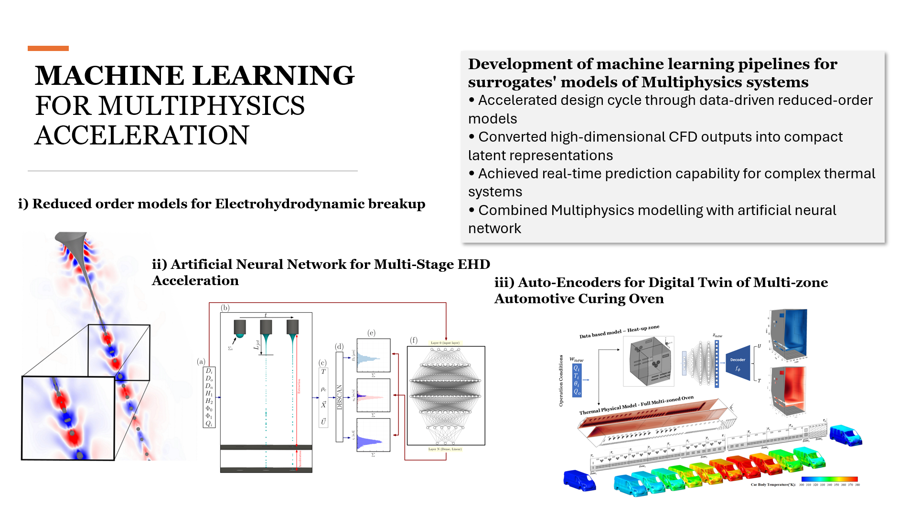

### Challenge
High-fidelity multiphysics simulations are too expensive to explore every operating condition of an industrial process.

### What I did
- **Developed surrogate models** using modal decomposition (POD, DMD) and deep learning (PyTorch, TensorFlow): autoencoders, recurrent and convolutional networks trained on CFD data.
- **Led the machine-learning development of an industrial digital twin** for an automotive paint-curing oven, predicting temperature and flow fields for operating conditions that were never simulated, to find hot spots and curing non-uniformities.

### Outcome
Reproduced spray deposition areas within about 1% using only 10% of the simulations; results published and the code released as open source.

### Code and links
- [electrostatic-spray-surrogate — GitHub](https://github.com/silviomcandido/electrostatic-spray-surrogate)
- [Physics of Fluids (2023)](https://doi.org/10.1063/5.0156571) · [Physics of Fluids (2024)](https://doi.org/10.1063/5.0205454) · [Int. J. Eng. Sci. (2023)](https://doi.org/10.1016/j.ijengsci.2023.103947)
