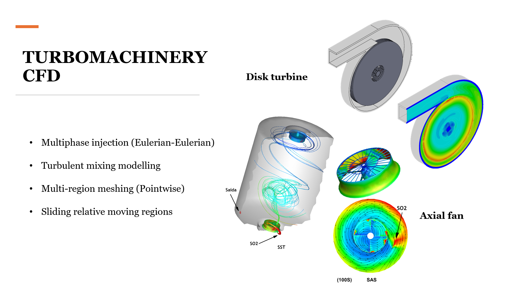

### Projects
- **CLOUD experiment chamber, CERN (MSc dissertation):** CFD of the mixing fans and gas injection in the CLOUD chamber, to assess and improve how uniformly gases mix inside it. [Dissertation](https://hdl.handle.net/10400.6/10068)
- **Disk pump / Tesla turbine (research internship):** 3D flow structures between the rotating disks.
- **Axial fans and mixing chambers:** rotating domains, turbulence modelling and multiphase injection.

### Tools
ANSYS Fluent, OpenFOAM, SolidWorks Flow Simulation.
