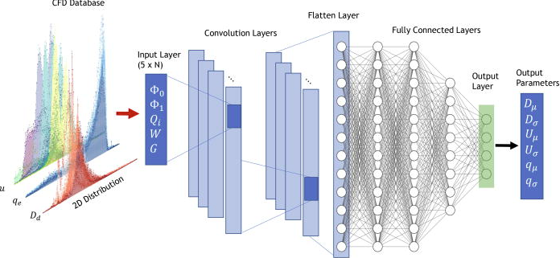

The Taylor cone jet is an electrohydrodynamic flow typically induced by applying an external electric field to a liquid within a capillary, commonly utilized in colloidal thrusters. This flow generation involves a complex multiphase and multiphysics process, with stability contingent upon specific operational parameters. The operational window is intrinsically linked to flow rate and applied electric voltage magnitude. High voltages can induce atomization instabilities, resulting in the production of an electrospray. Our study presents initially a numerical investigation into the atomization process of a Taylor cone jet using computational fluid dynamics. Implemented within OpenFOAM, our numerical model utilizes a volume-of-fluid approach coupled with Maxwell's equations to incorporate electric body forces into the incompressible Navier–Stokes equations. We employ the leaky-dielectric model, subjecting the interface between phases to hydrodynamic surface tension and electric stress (Maxwell stress). With this model, we studied the droplet breakup of a heptane liquid jet, for a range of operation of 1.53–7.0 nL s−1 and 2.4–4.5 kV of extraction. First, the developed high-fidelity numerical solution is studied for the jet breakup and acceleration of the droplets. Second, we integrate a machine learning model capable of extending the parametric windows of operation. Additionally, we explore the influence of extractor and acceleration plates on colloidal propulsion systems. This work offers a numerical exploration of the Taylor cone–jet transition and droplet acceleration using novel, numerically accurate approaches. Subsequently, we integrate machine learning models, specifically an artificial neural network and a one-dimensional convolutional neural network, to predict the jet's performance under conditions not previously evaluated by computationally heavy numerical models. Notably, we demonstrate that the convolutional neural network outperforms the artificial neural network for this type of application data, achieving a 2% droplet size prediction accuracy.

 

[Download paper here](https://doi.org/10.1063/5.0205454)

